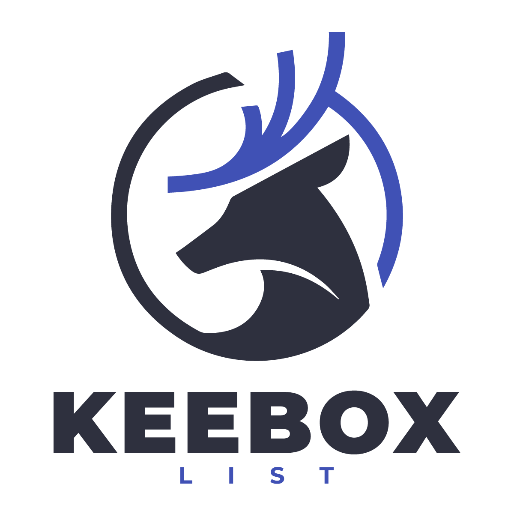
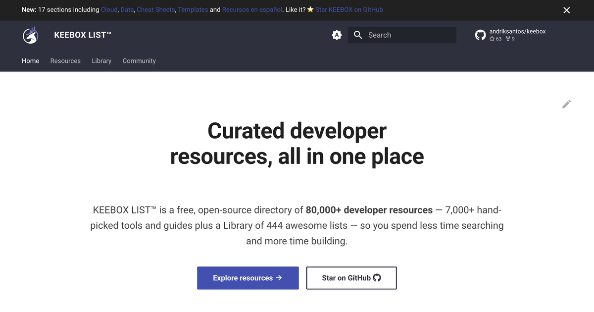

<div align="center">
	
	<br>
</div>

<p align="center">
	<a href="docs/contributing.md">Contribution guide</a>&nbsp;&nbsp;&nbsp;
	<a href="https://andriksantos.com/keebox/"><code> 🔥 VISIT THE OFFICIAL SITE: andriksantos.com/keebox 🔥 </code></a>&nbsp;&nbsp;&nbsp;
	<a href="docs/code-of-conduct.md">Code of conduct</a>
</p>

<p align="center">
	<a href="https://github.com/andriksantos/keebox/actions/workflows/ci.yml"></a>
	<a href="LICENSE"></a>
	<a href="https://github.com/andriksantos/keebox/stargazers"></a>
</p>

<p align="center">
	<sub>Your contributions are always welcome! 😎</sub>
</p>

---

# Welcome to **KEEBOX LIST™** | Developer Resources

KEEBOX LIST™ is a free, curated directory of **6,500+ hand-picked developer resources** — your centralized reference point to quickly find tools, libraries and guides relevant to your work.

## What will you find here?

| Section | What's inside |
| --- | --- |
| [AI & LLM Tools](https://andriksantos.com/keebox/ai/) | Local model runtimes, agents, MCP servers, RAG and vector databases |
| [Python](https://andriksantos.com/keebox/python/) | Modern tooling, web frameworks, data science and libraries |
| [Web Development](https://andriksantos.com/keebox/web/) | React, Vue, Svelte, Next.js, Tailwind, testing and build tools |
| [Node.js](https://andriksantos.com/keebox/nodejs/) | Packages, frameworks and learning resources |
| [npm](https://andriksantos.com/keebox/npm/) | Articles, tools and tips for the npm ecosystem |
| [DevOps & Self-hosting](https://andriksantos.com/keebox/devops/) | Containers, Kubernetes, IaC, CI/CD and monitoring |
| [iOS](https://andriksantos.com/keebox/ios/) | Courses, libraries and tools for iPhone and iPad apps |
| [Swift](https://andriksantos.com/keebox/swift/) | Swift libraries, guides and frameworks |
| [macOS](https://andriksantos.com/keebox/mac/) | Apps and tools for developers on the Mac |
| [Electron](https://andriksantos.com/keebox/electron/) | Apps, tools and boilerplates for Electron |
| [Learning & Free Resources](https://andriksantos.com/keebox/learn/) | Roadmaps, free courses and books, public APIs |
| [Awesome Lists Directory](https://andriksantos.com/keebox/lists/) | 600+ curated lists organized by topic |

## Why use KEEBOX LIST™?

With so many resources online, it can be hard to find the most relevant and reliable ones. KEEBOX LIST™ is curated and constantly evolving, created by developers for developers, to save you time and put the right tools in one place. Links are checked automatically every month.

## Run the site locally

The site is built with [MkDocs](https://www.mkdocs.org/) and [Material for MkDocs](https://squidfunk.github.io/mkdocs-material/).

```bash
python3 -m venv .venv && source .venv/bin/activate
pip install -r requirements.txt
mkdocs serve          # http://127.0.0.1:8000
mkdocs build --strict # production build into ./site
```

Every push to `master` is published to the `gh-pages` branch by the [official Material for MkDocs workflow](https://squidfunk.github.io/mkdocs-material/publishing-your-site/) in `.github/workflows/ci.yml`.

## How can you contribute?

This is an open-source project. If you have interesting resources to share or ideas to improve this list, we'd love your collaboration! Please read the [Contribution Guidelines](docs/contributing.md) first 👌🏻

---

## Preview

<div align="center">
	
</div>

---

## Share on

* [Share on X / Twitter](https://twitter.com/intent/tweet?url=https://andriksantos.com/keebox/&text=KEEBOX%20LIST%E2%84%A2%20-%20a%20curated%20collection%20of%20essential%20resources%20for%20developers%20%F0%9F%92%A1)
* [Share on LinkedIn](https://www.linkedin.com/sharing/share-offsite/?url=https://andriksantos.com/keebox/)
* [Share on Facebook](https://www.facebook.com/sharer/sharer.php?u=https://andriksantos.com/keebox/)

---

Questions about this list? Contact me at [andricksantos1@gmail.com](mailto:andricksantos1@gmail.com), visit [andriksantos.com](https://andriksantos.com) or open an issue on GitHub.

---

Copyright © 2018–2026 [Andrik Santos™](https://andriksantos.com). Released under the [MIT License](LICENSE).
